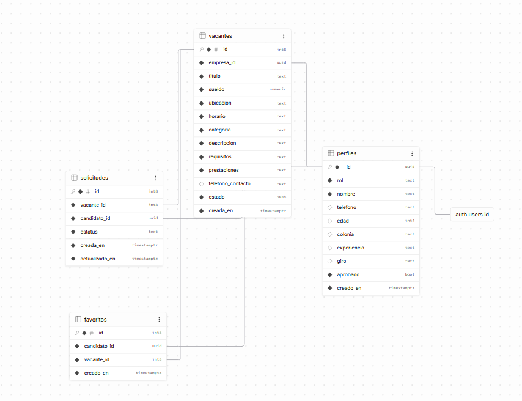

# AMAC — Bolsa de trabajo (Entrega 3: React, Supabase y Vercel)

Aplicación web SPA (Single Page Application) para la bolsa de trabajo de **asociAMayores A.C. (AMAC)**, diseñada con enfoque de accesibilidad para personas adultas mayores y empresas aliadas.

- **Sitio publicado (Vercel):** ⚠️ **`[PENDIENTE: pega aquí tu URL pública de Vercel, ej. https://amac-react.vercel.app]`**
- **Repositorio GitHub:** https://github.com/carlosaguilars05/amac-react
- **Video de presentación (12–15 min):** ⚠️ **`[PENDIENTE: pega aquí el enlace de YouTube (No listado) / Drive / OneDrive]`**
- **Diapositivas:** ⚠️ **`[PENDIENTE: pega aquí el enlace o PDF de las diapositivas]`**

---

## Integrantes y contribución

- **Amaury Pérez:** Configuración base del proyecto con Vite, React y Vercel (`package.json`, `package-lock.json`, `vite.config.js`, `vercel.json`, `index.html`, `.gitignore`, `.env.example`), migración y extensión del sistema de estilos accesibles (`src/styles/variables.css`, `base.css`, `layout.css`, `componentes.css`) y componentes reutilizables de interfaz (`src/components/Boton.jsx`, `Encabezado.jsx`, `Pie.jsx`, `EtiquetaEstatus.jsx`, `MensajeEstado.jsx`).
- **Juan Collado:** Conexión con Supabase y utilidades (`src/lib/supabase.js`, `constantes.js`), punto de entrada (`src/main.jsx`), contexto de autenticación (`src/context/AuthContext.jsx`), protección de rutas y tarjetas (`src/components/RutaProtegida.jsx`, `TarjetaVacante.jsx`), y flujo de acceso y candidato (`src/pages/Login.jsx`, `RegistroCandidato.jsx`, `DetalleVacante.jsx`, `Confirmacion.jsx`, `MisSolicitudes.jsx`, `VacantesFavoritas.jsx`, `MiPerfil.jsx`).
- **Carlos Aguilar:** Diseño de la base de datos PostgreSQL y políticas RLS (`supabase/esquema.sql`), enrutamiento principal (`src/App.jsx`), listado público con búsqueda y filtros (`src/pages/ListadoVacantes.jsx`), flujo completo de la empresa (`src/pages/RegistroEmpresa.jsx`, `EmpresaVacantes.jsx`, `PublicarVacante.jsx`, `SolicitudesRecibidas.jsx`), panel de administración AMAC (`src/pages/PanelAdmin.jsx`) y documentación final (`README.md`, `img/`).

- Azul marino: #202945
- Coral: #ff815c
- Azul claro: #cae4ef
- Durazno: #fddaad

## Tecnologías utilizadas

- **Frontend:** React 19, Vite 6, React Router DOM 7, CSS modular accesible (paleta AMAC, tipografías *Libre Baskerville* y *Work Sans* ≥ 18 px).
- **Backend / Base de datos:** Supabase (Auth con JWT, PostgreSQL, Data API automática y Row Level Security).
- **Despliegue:** Vercel con HTTPS, variables de entorno, soporte SPA (`vercel.json`) y despliegue continuo desde GitHub.

---

## Cómo correr el proyecto localmente

**Requisito:** Node.js 20 o superior (`node -v`).

1. Clonar el repositorio e instalar dependencias:
   ```bash
   git clone https://github.com/carlosaguilars05/amac-react.git
   cd amac-react
   npm install
   ```
2. Crear el archivo `.env.local` en la raíz del proyecto (ignorado por Git; nunca subirlo) usando `.env.example` como referencia:
   ```env
   VITE_SUPABASE_URL=https://tu-proyecto.supabase.co
   VITE_SUPABASE_PUBLISHABLE_KEY=sb_publishable_tu_llave_publica
   ```
   *(Usar únicamente la **Publishable key**, nunca la llave `service_role` / `secret`).*
3. Ejecutar el servidor de desarrollo:
   ```bash
   npm run dev
   ```
4. Abrir `http://localhost:5173` en el navegador.

---

## Cuentas de prueba

Todas las cuentas de demostración comparten la misma contraseña para facilitar la evaluación:

| Rol | Nombre | Correo | Contraseña | Estado |
|---|---|---|---|---|
| **Candidato aprobado** | María López Hernández | `candidato.aprobado@amac-demo.com` | `Amac2026!` | `aprobado = true` (puede postularse) |
| **Candidato sin aprobar** | Roberto Garza Martínez | `candidato.pendiente@amac-demo.com` | `Amac2026!` | `aprobado = false` (bloqueado por RLS al postularse) |
| **Empresa** | Grupo Comercial del Norte | `empresa@amac-demo.com` | `Amac2026!` | 6 vacantes publicadas (con y sin teléfono) |
| **Administrador AMAC (Extra)** | Coordinación AMAC | `admin@amac-demo.com` | `Amac2026!` | Acceso a `/admin` para aprobar candidatos |

---

## Base de datos y seguridad (PostgreSQL + RLS)

El script SQL completo con tablas, restricciones (`CHECK`, `FOREIGN KEY ... ON DELETE CASCADE`, `UNIQUE`), triggers, funciones auxiliares y políticas RLS se encuentra en [`supabase/esquema.sql`](supabase/esquema.sql).

### Diagrama relacional (Schema Visualizer)



### Políticas de Row Level Security (RLS — RF-010)

Todas las tablas tienen RLS activado (`ENABLE ROW LEVEL SECURITY`) y las contraseñas se gestionan exclusivamente mediante **Supabase Auth**:

- **Tabla `perfiles`:**
  - *Cada quien ve su perfil:* un usuario solo puede leer su propia fila (`id = auth.uid()`).
  - *Todos ven los perfiles de empresas:* permite mostrar el nombre y giro de la empresa en el listado y detalle de vacantes (`rol = 'empresa'`).
  - *La empresa ve a quien aplicó a sus vacantes:* permite a una empresa consultar únicamente el perfil de los candidatos que se postularon a sus vacantes (`public.empresa_ve_candidato(id)`).
  - *Admin ve todos los perfiles:* permite al rol `admin` revisar candidatos en el panel AMAC (`public.mi_rol() = 'admin'`).
  - *Cada quien edita su perfil + `REVOKE/GRANT` por columna:* un usuario solo puede actualizar `nombre`, `telefono`, `edad`, `colonia`, `experiencia` y `giro`; nadie puede modificarse a sí mismo `rol` ni `aprobado`. La aprobación desde `/admin` ocurre mediante la función segura `public.aprobar_candidato(cid, nuevo_estado)` (`SECURITY DEFINER`) que valida `public.mi_rol() = 'admin'`.
- **Tabla `vacantes`:**
  - *Ver vacantes activas o las propias:* cualquier visitante ve vacantes con `estado = 'activa'` y cada empresa ve todas las suyas (`activa`, `pausada`, `cerrada`).
  - *El candidato sigue viendo las vacantes a las que aplicó (RF-021):* mantiene visible el historial en *Mis solicitudes* incluso si la empresa pausa o cierra la vacante (`public.candidato_aplico(id)`).
  - *Admin ve todas las vacantes:* lectura administrativa para `public.mi_rol() = 'admin'`.
  - *Solo empresas publican, a su nombre / La empresa edita sus vacantes:* `INSERT` y `UPDATE` restringidos a `empresa_id = auth.uid()` y `rol = 'empresa'`.
- **Tabla `solicitudes`:**
  - *Candidato ve las suyas; empresa ve las de sus vacantes:* aislamiento estricto de postulaciones por propietario.
  - *Solo candidatos aprobados se postulan (RF-004, RF-054):* `INSERT` permitido únicamente si `candidato_id = auth.uid()`, `estatus = 'Enviada'` y `public.candidato_aprobado()` es `true`. La restricción `UNIQUE (vacante_id, candidato_id)` impide postularse dos veces (`23505`).
  - *Candidato cancela si no está resuelta (RF-006):* solo puede actualizar a `'Cancelada'` si el estatus actual es `'Enviada'` o `'En revisión'` (bloquea cancelar `'Aceptada'` o `'Rechazada'`).
  - *Empresa cambia el estatus (RF-024):* la empresa dueña de la vacante puede cambiar solicitudes no canceladas a `'En revisión'`, `'Aceptada'` o `'Rechazada'`.
  - *`REVOKE/GRANT` por columna + trigger `al_actualizar_solicitud`:* solo se puede modificar la columna `estatus`; el trigger actualiza automáticamente `actualizado_en`.
- **Tabla `favoritos` (Extra — RF-041):**
  - *Candidato ve, guarda y elimina únicamente sus propios favoritos* (`candidato_id = auth.uid()` y `rol = 'candidato'`).

---

## Tabla de requerimientos funcionales (RF) implementados

### Obligatorios (Sección 3.1)

| # | Requerimiento(s) | Funcionalidad | Estado |
|---|---|---|---|
| 1 | RF-001 | Listado de vacantes desde BD (solo `estado = 'activa'`) | ✅ Completo |
| 2 | RF-002, RF-007 | Búsqueda insensible a mayúsculas (título/ubicación) + filtros por horario y categoría + mensaje `"No hay vacantes para mostrar."` | ✅ Completo |
| 3 | RF-003, RF-051 | Detalle de vacante con botón `"Llamar"` (`tel:`) solo si tiene teléfono | ✅ Completo |
| 4 | RF-011, RF-012, RF-013 | Registro de candidato con todos los campos obligatorios y casillas de términos/privacidad | ✅ Completo |
| 5 | RF-008, RF-009 | Inicio y cierre de sesión con error genérico ante credenciales inválidas | ✅ Completo |
| 6 | RF-004, RF-054 | Postularme solo para candidatos aprobados, sin duplicados (`UNIQUE`) y confirmación en pantalla | ✅ Completo |
| 7 | RF-005, RF-006 | Mis solicitudes + cancelar con confirmación (bloqueado en `Aceptada`/`Rechazada`) | ✅ Completo |
| 8 | RF-015 | Registro simplificado de empresa | ✅ Completo |
| 9 | RF-019 | Publicar (y editar) vacante con validaciones y teléfono condicional | ✅ Completo |
| 10 | RF-020, RF-021 | Mis vacantes de la empresa con conteo de solicitudes y botones pausar / reactivar / cerrar | ✅ Completo |
| 11 | RF-022, RF-024 | Solicitudes recibidas con datos del candidato y cambio de estatus (`En revisión` / `Aceptada` / `Rechazada`) | ✅ Completo |
| 12 | RF-010 | Rutas protegidas por rol + seguridad real mediante RLS en PostgreSQL | ✅ Completo |

### Opcionales / Puntos extra (Sección 3.2)

| Requerimiento(s) | Funcionalidad | Estado |
|---|---|---|
| RF-054 | Panel de administrador (`/admin`) para aprobar o revocar candidatos | ✅ Completo |
| RF-014 / RF-017 | Editar perfil (`/perfil`) para candidatos y empresas | ✅ Completo |
| RF-041 | Vacantes favoritas (`Guardar vacante` y vista `/favoritos`) | ✅ Completo |
| RF-024 | Registro automático y visualización de fecha de cambio de estatus (`actualizado_en`) | ✅ Completo |
| RF-016 | Logo de empresa con Supabase Storage | ❌ Pendiente |
| RF-029 | Recuperar contraseña por correo | ❌ Pendiente |
| RF-055 | Proceso de selección por etapas | ❌ Pendiente |

---

## Accesibilidad y responsivo

Se conservó íntegro el sistema de diseño accesible de la Entrega 2:
- Paleta AMAC (`#202945`, `#ff815c`, `#cae4ef`, `#fddaad`) con alto contraste.
- Tipografía *Libre Baskerville* (títulos) y *Work Sans* con tamaño base `1.125rem` (18 px).
- Foco visible (`outline: 3px solid #ff815c`), enlace *"Saltar al contenido"*, etiquetas `label`/`htmlFor`, roles ARIA (`status`, `alert`) y diseño responsivo de `320 px` a `1440 px`.

> ⚠️ **`[PENDIENTE DESPUÉS DE DESPLEGAR EN VERCEL]:`** Correr **Lighthouse** sobre la URL de Vercel (meta: Accesibilidad ≥ 90), reemplazar `img/lighthouse.png` (y opcionalmente `img/index-celular.png` e `img/index-escritorio.webp`) y borrar estas notas `⚠️ [PENDIENTE...]` antes de la entrega final.
